## 🧑‍💻 About Me

I'm a software engineer with expertise in AI, backend and data engineering, and I'm most useful where those layers meet: where a model's answer turns into a price, a payment or a decision someone acts on. I've shipped a video generation platform with paying customers, a trade intelligence tool built on a million-plus rows of customs data, and document search that answers with its sources.

I own products end to end. I work directly with clients to turn loose requirements into a clear scope, build each feature across the stack, ship it, and improve it based on how people actually use it.

I care that AI output is correct, not just plausible. That means agents whose claims are checked in code, paid jobs that can't charge twice when a worker crashes, and data pipelines that give models measured facts instead of guesses.

### 🔹 What I Do

- 🚀 **Product engineering:** I work with clients to turn a loose idea into a clear scope and plan, make the technical trade-offs with them, and keep improving the product from real usage after launch.
- 🧠 **AI agents & LLM systems:** multi-agent systems that research, plan and act, with guardrails that check their claims in code before anyone sees them. I also build evaluation, model routing with fallback when a provider fails, careful prompt design, real-time voice (speech to text and text to speech) and generative video.
- 📚 **RAG & retrieval:** search over a team's own documents that finds the right passage and answers with a citation. I handle the whole path from parsing and chunking to embeddings, hybrid search and reranking, and I measure faithfulness and retrieval quality so improvements are proven, not assumed.
- 🤖 **Machine learning:** models for reinforcement learning, computer vision and language tasks, including face identity checks that keep characters consistent across generated video.
- 💻 **Backend engineering:** production services that handle payments, many customers and background work safely: billing and subscriptions, permissions per workspace, durable job queues, caching and horizontal scaling, designed so retries and crashes never charge twice or lose work.
- 🗂️ **Data engineering:** batch pipelines that turn large raw datasets into small, fast, analysis-ready tables, combined with live sources that are refreshed only as often as each one actually updates.
- 🖥️ **Full-stack delivery:** product UIs whose types come straight from the backend's API, so the frontend and backend can't quietly drift apart.
- ☁️ **Cloud & infrastructure:** containerised services on AWS with CI/CD, sized to stay fast and affordable, from free tiers to production traffic.
- 🎮 **Game engine development:** procedural geometry tools and editor plugins for Unreal Engine 5.

## 🔭 What I'm Building

- **[Whitespace](https://github.com/IzzatShahGit/whitespace):** shows exporters where to sell and helps them close the deal. It turns a million-plus rows of global customs data, covering 5,384 products from 24 exporting countries, into ranked export markets. Retrieval-grounded AI agents, which cite a source for every claim, then take each market to a deal: requirements, buyers, landed cost, quote and shipping documents. Next.js · FastAPI · LangGraph · Polars · DuckDB · PostgreSQL
- **[Vorpix](https://vorpix.ai):** turns one prompt into a narrated, branded video, ready to edit and publish. Paid generative-video jobs survive worker crashes without paying a provider twice, and credits are billed across Stripe and FastSpring. Rebuilding the script agent in code cut its token use by 97%. FastAPI · React · LangGraph · PostgreSQL · Redis · AWS ECS Fargate
- **[Adaptive Learn AI](https://github.com/IzzatShahGit/Adaptive-Learn-AI):** turns a learner's own files into study material. It provides RAG search over uploaded PDFs, slides and documents on Qdrant, and generates LLM quizzes from them across OpenAI, Groq and DeepSeek. FastAPI · Qdrant · PostgreSQL · Redis · MinIO
- **[AskDocs](https://github.com/IzzatShahGit/Docu-Chat-RAG):** lets teams chat with their own documents. It does multi-user conversational RAG over PDF, DOCX and HTML, rewrites follow-up questions using the chat history, retrieves from ChromaDB, and answers with citations to its sources. FastAPI · LangChain · ChromaDB · Streamlit

## 🧭 How I Build

- **Ship the whole slice.** Every feature goes out working end to end, from model to API to UI, scoped with the people who will use it.
- **The model writes; code decides what is true.** Numbers and facts are computed or verified in code before anyone sees them.
- **Anything that moves money is idempotent.** Retries and crashes never charge or pay twice.
- **Measure, then claim.** Tokens, cost and latency are recorded for every run and compared head to head.
- **One contract end to end.** Shared schemas and generated types, so a breaking change fails the build, not production.

## 🛠️ Skills

| Area | Tools |
|---|---|
| **Languages** |       |
| **Backend** |           |
| **Auth & architecture** |       |
| **Frontend** |          |
| **LLMs & agents** |            |
| **RAG & retrieval** |           |
| **Machine learning** |         |
| **Voice & generative media** |           |
| **Data engineering** |     |
| **Databases** |     |
| **Cloud & infrastructure** |            |
| **Quality & observability** |          |
| **Payments & auth providers** |    |
| **Game engines** |   |

## 🤝 Connect With Me

  
  

